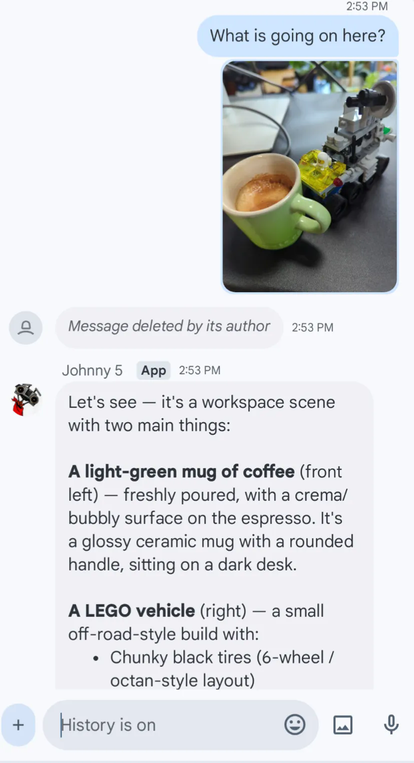

# pi-gchat-bridge

Bridge between **Google Chat** and the **pi coding agent**. Message a Google Chat
bot and it runs pi — with tools, skills, and per-space conversation history.



*pi* is a coding agent that runs on your machine with a session model, tools
and skills — see [pi.dev](https://pi.dev).

**Requires a Google Workspace account.** Custom Chat apps (bots) are only
available to Workspace organizations — personal Gmail accounts can use Chat
itself but can't install third-party Chat apps like this bridge.

## How messages arrive

Chat events are delivered via a **Cloud Pub/Sub pull subscription** — no public
endpoint, no tunnel, works for DMs *and* spaces. The bridge pulls events,
hands them to pi, and replies by posting a placeholder message that is **edited
in place** as pi streams, so you watch the answer appear live.

The bridge runs on **[Pi Durable](https://earendil.com/posts/pi-durable/)** — an
append-only, crash-safe conversation runtime. One process owns a SQLite store
(`bridge.sqlite`); Chat is a *client* of it, not the owner. That is what makes
**two frontends on one conversation** possible: the same conversation can be
watched and driven from Chat and from a browser at the same time (see
[Web frontend](#web-frontend)).

## One-time setup (Google Cloud Console)

1. **Create a project** at <https://console.cloud.google.com/projectcreate> (or reuse one).
2. **Enable the Google Chat API** (<https://console.cloud.google.com/apis/api/chat.googleapis.com>).
3. **Configure the Chat app** (<https://console.cloud.google.com/apis/api/chat.googleapis.com> → *Configuration*):
   - App name, avatar, description (e.g. "pi bridge")
   - **Do NOT** check "Build this Chat app as a Workspace add-on" (irreversible)
   - Connection settings → **Cloud Pub/Sub** → topic `projects/<project>/topics/chat-events`
   - Authentication Audience → **Project number**
   - Publishing: **"Specific people or group"** (add `your-email@example.com`) or *"Everyone in your organization"* — internal, no Google review
   - **Service account**: select the one created in step 4
4. **Create a service account** (IAM & Admin → Service Accounts → *Create service account*) and **download its JSON key** (Keys → Add key → JSON).
5. **Create the Pub/Sub topic + pull subscription** (Pub/Sub → Topics → *Create topic*):
   - Topic `chat-events`, subscription `chat-events-sub` (delivery type **Pull**)
   - Topic IAM: `chat-api-push@system.gserviceaccount.com` → **Pub/Sub Publisher** (required!)
   - Subscription IAM: `chat-bot@<project>.iam.gserviceaccount.com` → **Pub/Sub Subscriber**
6. In **Google Chat**, add the app to a space (or DM it) to install it.

## Local setup

**Prerequisites:** pi installed with provider API keys configured in
`~/.pi/agent`, and Node.js ≥ 22.19.

```bash
cd pi-gchat-bridge
npm install
cp .env.example .env
# edit .env: point GOOGLE_SERVICE_ACCOUNT_JSON at your key file
npm start            # runs the durable engine (tsx src/durable/main.ts)
```

For production, point your container at `./start-bridge.sh`, which supervises
the process, restarts it on crash, and starts cron and the local-model router.
`npm run start:sdk` runs the old SDK host instead.

That's it — the bot now answers messages in any space it's installed in, and
the same conversations are visible at `/web`.

## How it behaves

- **Live streaming replies** — after a short delay a "Thinking…" placeholder
  is posted and **patched in place** as pi generates the answer, so you watch the
  reply appear live. The patched text is sent with `markupSyntax: MARKDOWN`, so
  Markdown renders *while* it streams (code fences, bold, lists), not just at the
  end.
- **One conversation per thread** — keyed by thread, or by space for a
  non-threaded DM. Threads are fully independent conversations. Conversations
  live in the durable store, so they survive restarts *and* crashes: an
  interrupted turn is resumed, not lost. See
  [Session model & persistence](#session-model--persistence).
- **Interleaved messages (steer)** — sending a message while pi is working
  joins the *running* turn (`whenBusy: "steer"`): it is delivered after the
  current tool call finishes and before the next model call, so pi keeps its
  tool loop active and addresses your new message alongside the original work.
  Commands (`/help`, `/model`, `/settings`, `/resume`) instead interrupt the
  running reply.
- **pi extensions & skills work** — the session loads your `~/.pi/agent`
  extensions, so `/commands` and skills behave like in the TUI.
- **Images & text** — pasted (or uploaded) images are downloaded and passed to
  pi as multimodal input, so a vision model can describe what you send. Images
  can arrive with text or on their own (an image-only message is a valid
  prompt); non-image attachments are skipped with a notice.

  > Actually describing an image needs a **multimodal model** — a text-only
  > model won't see it (pi omits the image and the reply ignores it). The bot
  > still **can't send** images — that's a platform limit, see
  > [Known limitations](#known-limitations).

## Session model & persistence

Conversations live in **`bridge.sqlite`**, written by exactly one process. The
store is append-only: every model call, tool call and document change is a
commit, so an interrupted run resumes rather than being lost, and a message
that Pub/Sub redelivers is recognised by its id instead of being answered
twice.

- **The binding is a document, not a file.** A session-scoped document maps
  `chatKey → conversationId`, written in the *same commit* that creates the
  conversation, so a crash cannot leave a conversation no thread points at.
- **`/sessions`** lists conversations; **`/resume`** rebinds a thread to one of
  them. `/name` gives one a display name (Chat-side label only).
- **Legacy history was imported once.** `src/durable/import-all.ts` replays old
  JSONL sessions into the store. It is a one-shot migration tool, lossy by
  design (thinking, tool calls and branches stay in the JSONL files, which are
  never modified), not a live fallback.
- **One process owns the database.** `bridge.sqlite.lock` is a pid file: a
  second bridge refuses to start rather than serving the same Chat messages
  from a second, blind in-memory harness. Two supervisors cannot run either
  (`.start-bridge.pid`).

### Model and thinking level

- **`/model` in a conversation** switches **only that conversation** — one
  card with two dropdowns: model and thinking level. Both are applied with
  `conversation.configure()`, so they survive restarts and other conversations
  are unaffected. Neither changes the global defaults.
  > Switching models in a thread with a turn in flight **interrupts** that turn
  > (the new model cannot apply mid-turn). The following message then runs on
  > the new model.
- **Thinking in the `/model` card** lists **only the levels the selected
  model actually supports**, and re-renders when you change the model: the
  dropdown carries an `onChangeAction`, so Chat submits the form and the
  bridge patches the same card with that model's levels (they're per-model —
  pi's rule is `reasoning: false` → `off` only, otherwise everything except
  what `thinkingLevelMap` nulls out, with `xhigh`/`max` only when mapped).
  `— keep current —` stays available only when the current level is one of
  them; otherwise the dropdown pre-selects the level pi would clamp to (e.g.
  `medium` → `high` on a model that lacks `medium`), so the card never shows a
  level that can't happen. The confirmation still reports the level that took
  effect. Non-reasoning models (`reasoning: false` in `models.json`) are
  always `off`.
- **`/model` in a brand-new conversation** (no session yet) **starts that
  conversation** on the model you pick: the session is created on it (written
  as a `model_change` entry) and the bridge posts a gchat-only notice
  — *“Starting a new conversation with model …”* — that is never sent to pi.
  The global defaults are untouched.
- **Topic titles on the “Model switched” card.** When that card *starts* a
  conversation it becomes the thread's top message — i.e. the one line the
  space's conversation list shows — which says which model is running but
  nothing about the subject. So once the first reply has been posted, the
  bridge asks a **local model** (llama.cpp, no API cost, always available) for
  a one-line topic and patches only the card's **header**, keeping the
  "New conversation on *model*" body as it was:

  ```
  Sign requesting employees to monitor noise levels in a workspace
  ───
  New conversation on LFM3-VL-2B Q8 (local CPU, free) (llama-local).
  ```

  It runs **detached, after the reply**, so a slow CPU model never delays
  anything, and it reads only the first user message plus the first
  assistant reply, skipping thinking blocks and tool output. Images are
  forwarded, so a photo-only "what's going on here" gets a title too. The
  title is written **only to the Chat card**, never to the session file, so
  pi's history and prompt cache are untouched; `/name` still sets the session
  name separately. If the local model is down or too slow the card keeps the
  plain "Model switched" wording (no retry). Configure or disable with
  `BRIDGE_TOPIC_SUMMARY*` below.
- **`/settings`** (formerly `/defaultmodel`, still accepted as an alias)
  changes the **defaults for *new* conversations** in settings.json, again as
  model + thinking level, with the same dynamic thinking list.
  Existing conversations keep their own model and
  level — switch those individually with `/model` in each conversation.
  `defaultThinkingLevel` is model-independent, so it is clamped per model when
  a new conversation starts from it.
- **`/status`** shows the conversation's model and thinking level (or, with no
  conversation yet, the defaults that a new one would use).
- API access needs an API key scoped to the provider's models, or the model
  will appear in the picker but fail to be selected.

## Web frontend

The same conversations, in a browser. The bridge serves a small page (no build
step) at `/web` — or under whatever prefix a reverse proxy gives it.

- **`GET /web`** — the page
- **`GET /web/api/conversations`** — the index, newest first
- **`GET /web/api/c/:id/events`** — `text/event-stream`: whole snapshots plus
  the current tool status
- **`POST /web/api/c/:id/message`** — submit a message (`whenBusy: "steer"`)

**Why this is in-process, not a separate app.** Pi Durable's `viewState()` and
`subscribe()` are in-memory fan-out: any number of clients can attach to a
conversation *inside the process that owns it*. Its storage has no cross-process
change notification, so a server in another process could never see a Chat turn
commit. Chat and the browser are therefore two sinks on one conversation — a
turn started in Chat streams into the browser and vice versa — rather than two
conversations being replicated. This is also why a standalone web app (e.g.
`pi-pocket`) cannot be pointed at this store: it takes the store exclusively.

One `viewState()` per connected browser, seeded from its snapshot, so a client
connecting mid-turn paints the in-progress answer instead of a blank page.

**Reverse proxy.** The page is mount-agnostic: every URL is resolved relative to
the page's own directory, and the server strips an optional prefix before
`/web`, so both `/pi/web` (prefix passed through) and `/web` (prefix stripped)
work with no base-path configuration. Two proxy settings matter:

- **Buffer off** for `/web/api/` — otherwise SSE frames arrive in clumps
- **Read timeout above ~30 s** — the server sends a `keepalive` comment every
  15 s

**Security.** There is no per-user auth: anyone who can reach the port can read
every conversation and submit as the bot. Bind it to a tailnet or private
network, and set `BRIDGE_WEB_TOKEN` if it needs to listen more widely.

## Configuration

| Env var | Default | Meaning |
|---|---|---|
| `GOOGLE_SERVICE_ACCOUNT_JSON` | — (required) | Path to service account key |
| `PUBSUB_SUBSCRIPTION` | — (required) | `projects/.../subscriptions/...` |
| `PI_CWD` | bridge dir | Working dir for pi tools |
| `BRIDGE_ENGINE` | `durable` | `durable` (Pi Durable) or `sdk` (the old SDK host, kept for rollback) |
| `BRIDGE_DB` | `./bridge.sqlite` | The durable store. One process owns it |
| `BRIDGE_WEB_TOKEN` | — | Bearer token for web writes; empty = no check (tailnet-only) |
| `BRIDGE_SESSIONS_DIR` | `./sessions` | Legacy JSONL sessions — read by the importer and the old engine only |
| `BRIDGE_STATE_FILE` | `./state.json` | Legacy dedupe state — superseded by the store's submission ids |
| `PORT` | `8080` | Health endpoint (0 disables) |
| `BRIDGE_STALL_TIMEOUT_MS` | `1200000` (20 min) | Watchdog: force-reset a session streaming with no agent activity for this long (0 disables) |
| `BRIDGE_WATCHDOG_INTERVAL_MS` | `30000` | Watchdog scan interval |
| `BRIDGE_SESSION_IDLE_MS` | `0` | Evict an idle, non-streaming session from memory after this long (0 disables) |
| `ALLOWED_SPACES` | — | Comma-separated spaces (name or ID) the bridge responds in; empty = all |
| `ALLOWED_USERS` | — | Comma-separated users (name or ID) allowed to trigger pi; empty = anyone |
| `BRIDGE_REPLACE_ON_FINISH` | `1` | `1`: post the final answer as a new message (the completion notification), then delete the streaming placeholder (leaves a "Message deleted" stub). `0`: keep the patched placeholder as the answer (no stub; the notification is the one posted when the placeholder appears). |
| `BRIDGE_TOPIC_SUMMARY` | `1` | Re-title the `/model` "Model switched" card with a local-model topic line once the first reply lands. `0` keeps the plain wording. |
| `BRIDGE_TOPIC_SUMMARY_BASE_URL` | `http://127.0.0.1:8090/v1` | OpenAI-compatible endpoint of the local model used for titles (llama.cpp). |
| `BRIDGE_TOPIC_SUMMARY_MODEL` | `lfm3-vl-2b-q8` | Model id requested from that endpoint. |
| `BRIDGE_TOPIC_SUMMARY_TIMEOUT_MS` | `900000` (15 min) | Give up on a title after this long — CPU inference is slow and the server may have one slot. The job is detached, so waiting is free. |

## Testing

```bash
npm test
```

Runs the unit test suite (Node's built-in runner via `tsx`). It covers the pure
logic: projection of a durable view into a Chat reply, the Chat sink, the
router's dedupe/steering contract, the command layer's query semantics, the
web sink, and failure notices. Tests never open the live database or call a
model — the harness is reached through structural fakes.

```bash
npm run evals                             # local-model evals (topic titles)
npm run evals -- --case disk-space --judge
```

`evals/` holds the model-quality evals for jobs that aren't deterministic code —
currently the `/model` card titler. Cases are mined from real conversations in
`sessions/` and graded deterministically first, with an optional LLM judge for
the judgement calls. See `evals/README.md`.

### Stuck turns

The old watchdog (`BRIDGE_STALL_TIMEOUT_MS`) forced a hung *session* to reset.
On the durable engine this is the harness's job: a run that stops making
progress is parked and resumed on the next start, and `harness.resume()` runs
at startup. A turn that ends without an answer is now logged with its status,
reason, duration and conversation id, and Chat is told which of those it was —
*a stopped turn*, a *finished-but-empty* one, or a *failed* one — because those
need different responses from a person.

The historical case, kept for context:
The watchdog checks each streaming session for agent activity (any emitted
event) and, after `BRIDGE_STALL_TIMEOUT_MS` of silence, aborts the stuck run,
drops the incomplete trailing turn from the session file (so the hung tool call
is never re-run), and reopens the session. Deferred "busy" messages are then
redelivered by Pub/Sub to the fresh session.

## Roadmap

- [x] Pub/Sub receiver (DMs + spaces, no public endpoint)
- [x] Streaming replies (live in-place editing)
- [x] Pi Durable engine (crash-safe store, one conversation per thread)
- [x] Web frontend sharing conversations with Chat
- [ ] Artifacts (agent-published HTML/Markdown/SVG, versioned per id)
- [ ] Allowed-users filter (whitelist who can message the bot)
- [x] Parallel processing: per-thread sessions + concurrent dispatch (threads are independent; serial within a thread)

## Security notes

- The service account has **`chat.bot` scope only** — it can read messages in
  spaces it's in and post as the bot. It cannot touch your Drive/Mail/Calendar.
- pi sessions in the bridge get the **full default toolset** (`read`, `bash`,
  `edit`, `write`) against `PI_CWD`. Anyone who can message the bot can run
  commands — keep the app limited to your org / specific people.

## Known limitations

These are platform-level constraints (verified Aug 2026) — the bridge can't
work around them without external pieces:

- **Only one bridge may run at a time.** With multiple instances pulling the
  same Pub/Sub subscription, each message is delivered only to the instance
  that pulls it first, so replies get split across instances (each message
  goes to just one) rather than duplicated.

- **Personal Gmail accounts can't use the bridge.** Custom Chat apps (bots)
  are only available to Google Workspace organizations — a personal Gmail
  account can chat with a bot but can't install or develop one, so the bridge
  needs a Workspace account.

- **Markdown tables don't render — the bridge converts them.** Since Aug 2026
  replies go out with `markupSyntax: MARKUP_SYNTAX_MARKDOWN`, so standard
  Markdown (bold, italic, strikethrough, monospace, code fences,
  bulleted/nested/numbered lists, block quotes, links) renders properly in
  Chat. GFM pipe tables are *not* in the supported subset, and Chat's fallback
  is destructive: the rows are concatenated with **no** separator, so a table
  collapses into a run-on paragraph (`… F16258.1 ± 34.03.58 t/s…`) and swallows
  whatever line follows it. `src/chat-markdown.ts` therefore rewrites every
  outgoing message (posts, PATCHes, `/notify`) before it leaves the bridge:
  pipe tables become one bullet per row with the column names taken from the
  header (`- **Q8_0** — method: naive RTN from F16; PPL: 258.1 ± 34.0`),
  headings (`## x`, which Chat renders as a plain bold line) become `**x**`,
  and single line breaks become CommonMark hard breaks (two trailing spaces,
  verified supported) so lines aren't glued together — a plain `\n` inside a
  paragraph is joined with a space. Fenced code blocks pass through untouched.
  There is still no real table widget (cards don't have one either), and the
  model is also told up front not to emit tables (`chat-format` extension in
  `pi-agent/extensions/`), which reads better than a mechanical conversion.
  Tracked upstream: [issue 428659965](https://issuetracker.google.com/issues/428659965).

- **Streamed placeholders render Markdown (Oct 2026).** A text PATCH keeps the
  message in Markdown syntax as long as `markupSyntax` is sent **in the body**
  (`updateMask=text`); only the field-mask form (`updateMask=text,markupSyntax`
  or `updateMask=markupSyntax`) still 400s with "Unsupported path name in message
  field mask". Send a PATCH *without* the field and the message drops back to
  legacy Chat syntax.

- **Sentences are never split mid-line.** Replies longer than the 4,000-char
  message cap are chunked at a line boundary where one exists (`splitMessage`),
  and a fenced code block that straddles the cut is closed at the end of one
  chunk and reopened at the start of the next, so the second half isn't
  rendered as prose.

- **The "Message deleted" stub is a notification trade-off.** Notifications fire
  on message *creation*, not on a PATCH (with app auth there is no other
  notify-on-update hook), so with `BRIDGE_REPLACE_ON_FINISH=1` (default) the
  answer is posted as a new message — that create is the "reply is ready" ping —
  and the placeholder is deleted afterwards, which leaves the stub. The answer
  is created *before* the placeholder is deleted, so a failed create falls back
  to keeping the streamed placeholder as the answer instead of losing the reply.
  With `BRIDGE_REPLACE_ON_FINISH=0` the placeholder becomes the answer (no stub,
  no duplicate message), but the ping is the one emitted when "Thinking…"
  appears — and in a top-level conversation the placeholder is then *not* sent
  silent, otherwise a slow reply would arrive with no notification at all.

- **Threaded conversations get more than one notification per reply.** In a
  thread you'll get a ping for the "Thinking…" placeholder, another for the
  relocated placeholder after a steering message, and — with the default
  `BRIDGE_REPLACE_ON_FINISH=1` — one for the final answer. Google's API rejects
  `silent` for threaded messages (403 when combined with `messageReplyOption`,
  verified Aug 2026) and thread placement isn't patchable, so a silent message
  inside an existing thread isn't possible. Top-level (non-threaded)
  conversations get exactly one notification.

- **Bots can't upload media attachments.** The `attachments:upload`
  (`media.upload`) endpoint rejects service-account auth outright
  ("This method doesn't support app authentication with a service account")
  — even with `chat.messages` claimed on the service-account token. It
  requires **user delegation**: user OAuth (`chat.messages` scope, one-time
  consent) or Workspace **domain-wide delegation** (service account
  impersonating a user). Either way the attachment message is attributed to
  the delegated user, not the bot, so inline images from pi aren't possible
  with the current `chat.bot`-only setup. Tracked upstream:
  [issue 447642391](https://issuetracker.google.com/issues/447642391).

- **No typing/thinking indicators.** The Chat API currently has no support
  for typing or thinking indicators for bots — the bridge fakes liveness with
  the delayed "Thinking…" placeholder instead. Tracked upstream:
  [issue 166140696](https://issuetracker.google.com/issues/166140696).

## Disclaimer

This is a personal project. The views, code, and opinions expressed here are
my own and do not represent those of my current or past employers.
